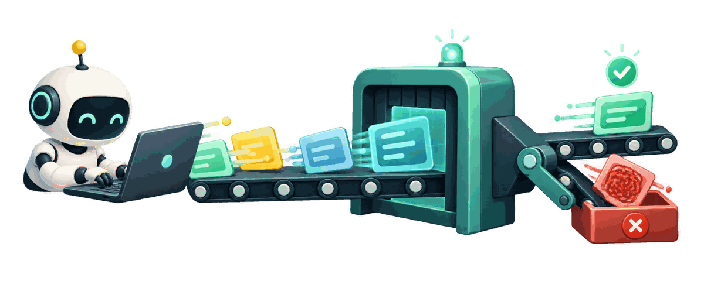
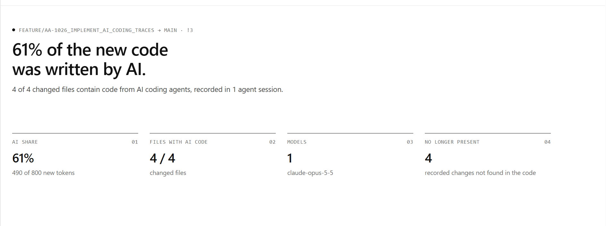
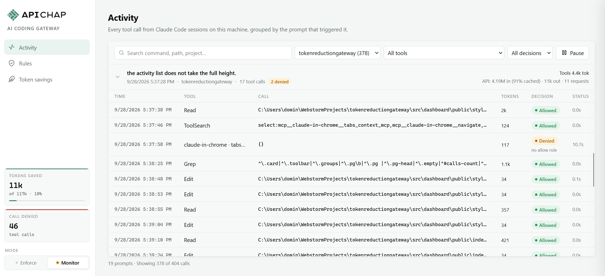
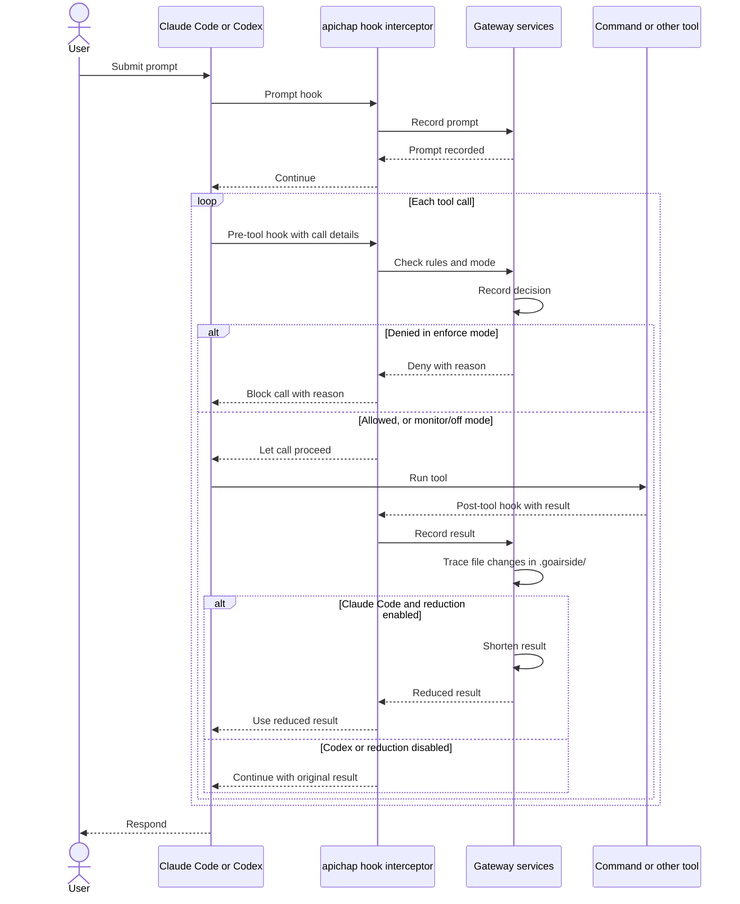

<h1 align="center">
  
  apichap AI Coding Gateway
</h1>

<p align="center">
  
</p>

<h3 align="center">Audit every tool call. Trace every AI change in your code.</h3>
<br/>
<p align="center">
  <a href="https://www.npmjs.com/package/apichap-ai-coding-gateway"></a>
  
  
  
  <a href="LICENSE"></a>
</p>
<br/>

A local gateway for Claude Code and Codex. It checks every tool call against your rules and records every change the agent makes to your code. Your merge requests then show how much of the new code was written by AI.


## Get a report on every AI generated line of code in your CI

Every time the agent writes to a file, the gateway records what it added in a small trace file inside your project (`.goairside/traces`). Commit the trace files with your code. From them, the gateway builds a full report for a branch or merge request: how much of the new code AI wrote, in which files and lines, and with which models.

<p align="center">
  
</p>

Trace files contain no code: only short hashes of what was written. See [Trace format](docs/trace-format.md).

With the AI change report in your CI, every pull request on GitHub and every merge request on GitLab shows which lines AI wrote:

- **GitHub:** a check marks the AI code in **Files changed**, and the run summary shows the AI share per file.
- **GitLab:** each AI change appears in the merge request's **Code Quality** widget, and the full HTML report is a job artifact.

The gateway adds this CI job automatically when a project gets its first trace file. You can also add it yourself from the dashboard or by hand. See [AI change report in CI](#ai-change-report-in-ci).

## Audit every tool call. And deny the bad one.

Every tool call the agent makes goes through the gateway before it runs. It is checked against your rules: allowed, denied with a reason the agent can read, or reported only, depending on the [mode](#modes). The dashboard shows each call live, grouped by the prompt that started it. When a call is denied, you can allow it from there with one click.

<p align="center">
  
</p>

## Install

### Claude Code

```bash
npx apichap-ai-coding-gateway init --agent claude
```

### Codex

```bash
npx apichap-ai-coding-gateway init --agent codex
```

### Open the dashboard

```bash
npx apichap-ai-coding-gateway dashboard
```

New agent sessions are now checked and traced. The default mode is **enforce**.

## Documentation

- [How it works](#how-it-works)
- [Supported agents](#supported-agents)
- [AI change report in CI](#ai-change-report-in-ci)
- [AI coding traces](#ai-coding-traces)
- [Dashboard](#dashboard)
- [Rules](#rules)
- [Modes](#modes)
- [Token reduction](#token-reduction)
- [Command line](#command-line)
- [Data and privacy](#data-and-privacy)
- [Limitations](#limitations)
- [Development](#development)
- [License](#license)

### How it works

The gateway uses hooks in Claude Code and Codex to see tool calls before they run and results after they finish. It checks each call against your rules, records what happened and what the agent wrote, and can shorten results before they return to the conversation. The agent's own permission checks still apply; the gateway adds restrictions.



### Supported agents

Install the integration you use. All integrations share the same rules, mode, dashboard and local history.

#### Claude Code

```bash
npx apichap-ai-coding-gateway init --agent claude
```

Claude Code hooks are added to `~/.claude/settings.json` (or `$CLAUDE_CONFIG_DIR/settings.json`). Supports rule checks, traces and token reduction.

#### Codex

```bash
npx apichap-ai-coding-gateway init --agent codex
```

Codex hooks are added to `$CODEX_HOME/hooks.json` (or `~/.codex/hooks.json`). Review and trust the hooks in Codex before they run. Supports rule checks, traces and activity tracking; token reduction is not available for Codex yet.

To remove an integration's hooks, pass the same agent name:

```bash
npx apichap-ai-coding-gateway uninstall --agent claude
```

`init` backs up the settings file, keeps other settings and hooks, and replaces earlier gateway hooks. You can run it again safely.

### AI change report in CI

The `report` command compares a merge request (or push) with its base. It reads the trace files committed in that range and looks up their recorded content in the changed files. It writes the HTML report to `goairside-report/index.html`, and in CI also the GitHub or GitLab output described below. Everything runs inside the CI job, from the checkout. The only network call is the GitHub check, sent to GitHub itself.

**What you need to know first**

- **Commit `.goairside/`.** The report only sees trace files that are committed in the compared range. Without them, the report shows 0%.
- **The job needs the full Git history** to compare with the base branch: `fetch-depth: 0` on GitHub, `GIT_DEPTH: 0` on GitLab. The templates set this.
- **The share counts words and symbols, not lines.** Formatting and quote style don't change it. If a human rewrites AI code, that part stops counting as AI.
- **"No longer present"** lists recorded changes the report can't find in the code anymore, for example because they were rewritten, reverted or deleted.
- **Pin the version** in the job (`apichap-ai-coding-gateway@1.2.3` instead of `@latest`) to get the same results on every run. Automatic setup pins the version you have installed.

#### Automatic setup

When a project gets its first trace file, the gateway adds the job for each CI that the repository already uses:

| CI             | Detected by                         | Files written                                                                 |
| -------------- | ----------------------------------- | ----------------------------------------------------------------------------- |
| GitHub Actions | a `.github/workflows/` folder       | `.github/workflows/goairside-report.yml`                                      |
| GitLab CI      | a `.gitlab-ci.yml` file             | `.gitlab/goairside-report.yml`, plus an `include:` line in `.gitlab-ci.yml`   |

Existing files are never overwritten, so your own edits stay. Review the new files and commit them. To turn automatic setup off, use **Settings → Git pipeline report** in the dashboard.

To add the job to a project that already has traces, open **Settings → Set up pipeline report now** in the dashboard, pick the project, and choose **Set up**.

#### GitHub Actions

The workflow runs on every pull request. It produces:

- a **step summary** on the run page: AI share, files with AI code, models, sessions;
- a **goAirside check** on the pull request, with one annotation per file on its first AI line, shown in **Files changed**;
- the HTML report as the **goairside-report** artifact.

To set it up by hand, save this as `.github/workflows/goairside-report.yml` (the same file as [the template](pipeline/github-pipeline-template.yml)):

```yaml
name: goAirside report

on:
  pull_request:

permissions:
  contents: read
  checks: write # for the goAirside check; without it you still get the summary and the artifact

jobs:
  report:
    runs-on: ubuntu-latest
    steps:
      - uses: actions/checkout@v7
        with:
          fetch-depth: 0
      - uses: actions/setup-node@v7
        with:
          node-version: 22
      - name: AI change report
        run: npx -y apichap-ai-coding-gateway@latest report --out goairside-report
        env:
          GITHUB_TOKEN: ${{ github.token }}
      - uses: actions/upload-artifact@v4
        with:
          name: goairside-report
          path: goairside-report/
```

Good to know:

- The check needs `checks: write` and `GITHUB_TOKEN` passed to the step. Without them, the check is skipped and the log says why.
- Pull requests from forks get a read-only token, so they get the summary and artifact but no check.

#### GitLab CI

The job runs in merge request pipelines and in branch pipelines:

- **Merge request pipelines** write the HTML report (artifact) and a **Code Quality** report with one finding for each AI change.
- **Branch pipelines** write only the Code Quality report. GitLab needs it on the target branch to compare against.

To set it up by hand, save [the template](pipeline/gitlab-pipeline-template.yml) as `.gitlab/goairside-report.yml` and include it from `.gitlab-ci.yml`:

```yaml
include:
  - local: .gitlab/goairside-report.yml
```

Or add the job to `.gitlab-ci.yml` directly:

```yaml
goairside-report:
  image: node:22
  rules:
    - if: $CI_PIPELINE_SOURCE == "merge_request_event"
    - if: $CI_COMMIT_BRANCH
  variables:
    GIT_DEPTH: 0
  script:
    - npx -y apichap-ai-coding-gateway@latest report --out goairside-report
  artifacts:
    paths: [goairside-report/]
    reports:
      codequality: goairside-report/gl-code-quality.json
```

Good to know:

- **GitLab only shows Code Quality findings that are new compared with the target branch's report.** So the target branch (for example `main`) needs a pipeline that ran this job. The first merge request after setup shows nothing in the widget until that pipeline has run. The HTML report in the artifacts works from the start.
- Every branch that is the target of a merge request (such as `develop` → `main`) needs its own branch pipeline with the job. That is why the template runs on branches too.
- If your project has no `workflow:` rules, a branch with an open merge request may run two pipelines (branch and merge request). That is expected.
- The Code Quality widget is available on every GitLab tier. Markers inline in the **Changes** tab depend on your GitLab tier.
- Automatic setup only adds the `include:` line when `.gitlab-ci.yml` has no `include:` or uses an `include:` list. For other forms, it writes a note to the error log, and you add the line by hand.

#### Run the report locally

```bash
npx apichap-ai-coding-gateway report                 # current branch against the default branch
npx apichap-ai-coding-gateway report --base develop  # against another branch or commit
```

It prints the AI share and writes `goairside-report/index.html`. Options: `--base <branch|commit>`, `--head <commit>` (default `HEAD`), `--out <folder>`.

### AI coding traces

While an agent session runs, the gateway records each write to a file in the project: whole files the agent writes, the new parts of edits and patches, and shell commands that contain the written text themselves (`cat > file <<EOF`, `Set-Content`, …). Each session writes its own file in `.goairside/traces/`, so branches never conflict when merging. Sessions that only read leave no file behind.

Not recorded: deletions, files outside the project, and changes that formatters or scripts make. Turn tracing off under **Settings → Trace files**. The full format is in [docs/trace-format.md](docs/trace-format.md).

### Dashboard

```bash
npx apichap-ai-coding-gateway dashboard
```

- **Activity**: tool calls grouped by the prompt that started them. Open a call to see its details, its result, and the rule that decided it.
- **Rules**: policies and rules, import and export.
- **Token savings**: reduction options and the savings they produced.
- **Settings** (from the environment menu at the bottom of the sidebar): the mode, switches for token savings, trace files and the Git pipeline report, and setting up the pipeline report for a project right away.

The dashboard runs on this computer at `127.0.0.1`. Use `--port <number>` to choose a port or `--no-open` to keep it from opening a browser tab.

### Rules

Rules say which tool calls are allowed or denied. They are organised into groups, each with a plain-language policy title such as **The agent is not allowed to delete files**. You can turn a group off, edit its rules, move a rule to another group, or create your own group.

The decision order is simple:

1. A matching **deny** rule blocks the call. Deny rules always win.
2. Otherwise, a matching **allow** rule lets it proceed to the agent's own permission checks.
3. If no allow rule matches, the call is denied as **unlisted**.

For example, `Shell(git *)` allows Git commands in Bash and PowerShell, while `Bash(git status)` matches only that Bash command. `FileRead({cwd}/**)` applies to reading and searching inside the current project. In patterns, `*` matches within one folder and `**` can cross folders. `{cwd}`, `{home}`, and `{tmp}` stand for the project, home, and temporary folders.

**When a call is denied:** open it on the Activity page and choose **Allow this call…**. For an unlisted call, the gateway suggests an exact rule and a broader rule; choose the narrowest one that fits. You can add it to the suggested group or choose another group. If a deny rule blocked the call, an allow rule cannot override it: edit or disable that deny rule instead.

The dashboard's **Import…** and **Export** actions let you move rules between installations. Import shows a preview first: **Add** keeps existing rules and adds new ones; **Replace** removes the current rules before importing.

### Modes

Choose the mode in the dashboard sidebar or under **Settings**:

| Mode                | What happens                                                                                             |
| ------------------- | -------------------------------------------------------------------------------------------------------- |
| `enforce` (default) | Blocks calls denied by a rule and calls no allow rule covers. If the gateway fails, the call is blocked. |
| `monitor`           | Checks and records calls, including ones that would be denied, but lets them run.                        |
| `off`               | Skips rule checks and records calls.                                                                     |

The selected mode is saved and remembered after a restart. `APICHAP_GATEWAY_MODE` overrides the saved setting when set.

### Token reduction

Token reduction shortens tool results before they reach the conversation. In Claude Code, turn individual options on or off from **Token savings** in the dashboard, or turn the feature off completely under **Settings**. The page describes each option and shows its savings. Token reduction is not available for Codex yet.

Options include removing terminal color codes and repeated output, compacting JSON, condensing test and build logs, paging through long results, and limiting large reads or search results. Each option has its own default. A shortened result explains what was omitted and how to retrieve more; long results can be paged through with Read.

### Command line

Use `npx apichap-ai-coding-gateway` or the global `apichap-gateway` command:

```bash
npx apichap-ai-coding-gateway init --agent claude|codex       # register the hooks
npx apichap-ai-coding-gateway uninstall --agent claude|codex  # remove them again
npx apichap-ai-coding-gateway dashboard [--port 4717] [--no-open]
npx apichap-ai-coding-gateway report [--base <branch|commit>] [--head <commit>] [--out goairside-report]
```

Rules, the mode, features and token reduction are managed in the dashboard. Run `npx apichap-ai-coding-gateway` without a command to see the command list.

### Data and privacy

The gateway keeps its local history, settings and rules in `~/.ai-coding-gateway/gateway.sqlite`. It also writes an error log and may keep full results for long calls that were shortened; those temporary results are removed after three days. Set `APICHAP_GATEWAY_DIR` to use a different folder.

Trace files live in each project's `.goairside/traces/` and contain no code, only hashes of the written content, the file path, the time, the tool and the model. The CI report runs inside your own CI job. Nothing here requires a hosted account.

### Limitations

The gateway is a guardrail, not a sandbox. It checks tool calls against your rules, but an agent may still perform a risky action through a command your rules allow, for example by running a script in the project. Use operating-system or container isolation when you need a stronger boundary.

Traces cover what the agent writes through its own tools. Code that a script, formatter or generator produces at the agent's request is not counted as AI code.

### Development

```bash
npm install
npm test
npm run typecheck
npm run build
npx tsx src/main.ts dashboard
```

To run hooks from this checkout while developing:

```bash
npx tsx src/main.ts init --agent claude --local
# Or connect Codex:
npx tsx src/main.ts init --agent codex --local
```

The hooks use the source on the next tool call, so a rebuild is not needed. To return to the installed package, run `init --agent claude` or `init --agent codex` again. New agent sessions pick up hook changes. In an existing Claude Code session, confirm them with `/hooks`.

For the project layout and contribution guidelines, see [CONTRIBUTING.md](CONTRIBUTING.md).

### License

[GNU General Public License v3.0](LICENSE)
