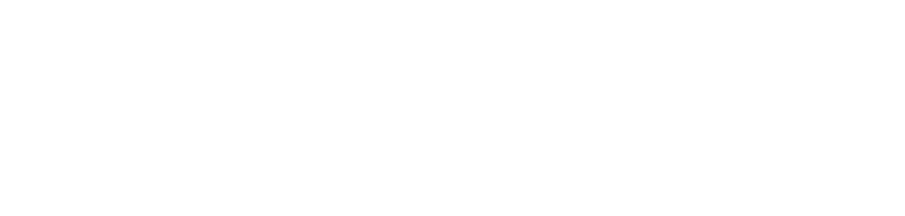
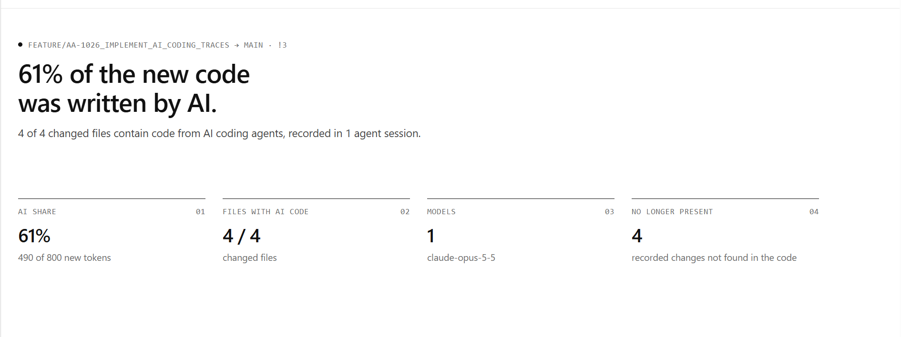

<p align="center">
  <a href="https://viewtower.ai"></a>
</p>

<h3 align="center">The all-in-one AI-Coding Governance Platform.</h3>

<p align="center">
  The open-source client of <a href="https://viewtower.ai"><b>viewtower.ai</b></a>, the AI coding governance platform.
</p>

<p align="center">
  <a href="https://www.npmjs.com/package/viewtower"></a>
  
  
  
  <a href="LICENSE"></a>
</p>

<p align="center">
  <a href="#install-in-30-seconds"><b>Install</b></a> ·
  <a href="#documentation"><b>Docs</b></a> ·
  <a href="https://viewtower.ai"><b>viewtower.ai</b></a>
</p>

---

Your AI-Coding agent codes hundreds of lines a day on your machine. Do you know?

**viewtower is an AI-Coding Governance Platform between your coding agent and your machine.** You see every tool call before it runs, and you stop the ones you don't want. You also learn exactly which lines of code AI wrote. It's free, open source, and runs locally on your computer.

- 🛡️ **Stop risky actions instantly.** Every tool call is checked against your rules *before* it runs. `rm -rf`, reading `.env`, force-pushing: denied, with a reason your agent understands.
- 🔍 **See everything your agent does.** A live dashboard shows each call, grouped by the prompt that started it.
- 🧾 **Know which code AI wrote.** Every pull request shows the share of AI code, line by line, and which model wrote it.
- 💸 **Spend fewer tokens.** Noisy tool output is trimmed before it reaches the model. Your agent won't notice. Your AI bill will.

## Install in 30 seconds

```bash
npx viewtower init --agent claude   # Claude Code
npx viewtower init --agent codex    # Codex
```

That's it. Open the local Development Dashboard with: 

```bash
npx viewtower dashbaord
```

## What you get

### Audit every tool call. And stop the bad ones.

Every command, file read and file write your agent tries goes through viewtower first. It is allowed, blocked with a reason the agent can read, or just recorded. If something you need was blocked, allow it from the dashboard with one click.

### See every AI-written line in your pull requests

viewtower records what your agent writes. A CI job then adds a report to every pull request (GitHub) and merge request (GitLab): how much of the new code AI wrote, in which files, and with which model.

<p align="center">
  
</p>

The job sets itself up the first time your agent writes code in a project. Trace files contain no code, only short hashes.

## Open source or managed: your choice

This repository is the **viewtower client**. You can use it in two ways:

|                                | **Open source** (this repo)  | **Managed** by [viewtower.ai](https://viewtower.ai)               |
| ------------------------------ | ---------------------------- | ----------------------------------------------------------------- |
| Rules, dashboard, CI report    | ✅                           | ✅                                                                |
| Token savings                  | ✅                           | ✅                                                                |
| Who sets the rules             | You, on your machine         | Your company, synced to every developer                           |
| Team-wide audit trail          | –                            | ✅                                                                |
| Company-wide mode (enforce/monitor) | –                       | ✅                                                                |
| Price                          | Free, forever                | Free for up to 3 users, then [see plans](https://viewtower.ai)    |

Both use the same client. If your company invites you, one command connects you:

```bash
npx viewtower login
```

**Running AI coding across a team?** Set guardrails once, roll them out to everyone, and get clear audits. Your company sets the guardrails. Your developers keep choosing their tools.
👉 **[Get started at viewtower.ai](https://viewtower.ai)**. Takes 5 minutes, no credit card.

---

## Documentation

1. [How it works](#how-it-works)
2. [Supported agents](#supported-agents)
3. [Dashboard](#dashboard)
4. [Rules](#rules)
5. [Modes](#modes)
6. [AI change report in CI](#ai-change-report-in-ci)
7. [AI coding traces](#ai-coding-traces)
8. [Token savings](#token-savings)
9. [Managed mode (company login)](#managed-mode-company-login)
10. [Command line](#command-line)
11. [Data and privacy](#data-and-privacy)
12. [Limitations](#limitations)
13. [Contributing](#contributing)
14. [License](#license)

### How it works

viewtower installs hooks in Claude Code and Codex. With them it sees every tool call **before** it runs and every result **after** it finishes.

1. **Before a call:** viewtower checks it against your rules. Allowed calls continue. Denied calls are blocked, and the agent gets the reason.
2. **After a call:** viewtower records the result and, if the agent wrote code, a trace in your project. In Claude Code, long results can be shortened before the agent reads them.

Your agent's own permission prompts still apply. viewtower only adds restrictions; it never removes any.

```mermaid
sequenceDiagram
    participant Agent as Claude Code / Codex
    participant VT as viewtower
    participant Tool as Command or file

    Agent->>VT: I want to run this
    alt Denied by a rule
        VT-->>Agent: Blocked, with the reason
    else Allowed
        VT-->>Agent: Go ahead
        Agent->>Tool: Run
        Tool-->>VT: Result
        VT->>VT: Record the call, trace written code
        VT-->>Agent: Result (shortened if long)
    end
```



### Supported agents

All agents share the same rules, mode, dashboard and history.

| Agent           | Install                                | Hooks are written to                                              | Rules | Traces | Token savings |
| --------------- | -------------------------------------- | ----------------------------------------------------------------- | :---: | :----: | :-----------: |
| **Claude Code** | `npx viewtower init --agent claude`    | `~/.claude/settings.json` (or `$CLAUDE_CONFIG_DIR/settings.json`) |  ✅   |   ✅   |      ✅       |
| **Codex**       | `npx viewtower init --agent codex`     | `~/.codex/hooks.json` (or `$CODEX_HOME/hooks.json`)               |  ✅   |   ✅   |  coming soon  |

Good to know:

- `init` backs up your settings file first and keeps your other settings and hooks. Running it again is safe.
- **Codex:** review and trust the new hooks in Codex before they run.
- New agent sessions pick up the hooks. In a running Claude Code session, confirm them with `/hooks`.

To remove viewtower from an agent:

```bash
npx viewtower uninstall --agent claude
```

### Dashboard

```bash
npx viewtower dashboard
```

The dashboard runs on your computer at `http://127.0.0.1:4717/`. It has four pages:

- **Activity:** every tool call, grouped by the prompt that started it. Open a call to see its details, its result and the rule that decided it.
- **Rules:** your policies and rules. Import and export them.
- **Token savings:** the options that shorten tool output, and how many tokens they saved.
- **Settings** (environment menu, bottom of the sidebar): the mode, and switches for token savings, trace files and the CI report.

It keeps running in the background. `init` opens it in your browser and signs it in with an access token; your browser remembers the token after that. To connect another browser, run `npx viewtower dashboard` once.

Options: `--port <number>` to use another port, `--no-open` to skip opening the browser.

### Rules

Rules decide which tool calls are allowed. They are grouped under plain-language policies, such as **The agent is not allowed to delete files**. You can turn a group off, edit its rules, move rules between groups, or create your own groups.

**How a call is decided:**

1. A matching **deny** rule blocks the call. Deny always wins.
2. Otherwise, a matching **allow** rule lets it continue.
3. If no rule matches, the call is blocked as **unlisted**.

**Rule examples:**

| Rule                   | Matches                                                  |
| ---------------------- | -------------------------------------------------------- |
| `Shell(git *)`         | any Git command, in Bash and PowerShell                  |
| `Bash(git status)`     | exactly this Bash command                                |
| `FileRead({cwd}/**)`   | reading and searching anywhere in the current project    |

In paths, `*` matches within one folder and `**` matches across folders. `{cwd}`, `{home}` and `{tmp}` stand for the project, home and temp folders.

**A call was blocked and you need it?** Open it on the Activity page and choose **Allow this call…**. viewtower suggests an exact rule and a broader one; pick the narrowest that works. If a *deny* rule blocked it, an allow rule can't override it. Edit or turn off that deny rule instead.

**Share rules:** use **Export** and **Import…** on the Rules page. Import shows a preview first. **Add** keeps your rules; **Replace** removes them first.

### Modes

Pick the mode in the dashboard sidebar or under **Settings**:

| Mode                  | What happens                                                                                          |
| --------------------- | ----------------------------------------------------------------------------------------------------- |
| `enforce` (default)   | Blocks denied and unlisted calls. If viewtower itself fails, the call is blocked too (fail closed).   |
| `monitor`             | Records everything, including calls it *would* block, but lets them all run. Great for a trial run.   |
| `off`                 | No rule checks. Calls are still recorded.                                                             |

The mode is saved. To override it, for example in a script, set `VIEWTOWER_GATEWAY_MODE=enforce|monitor|off`.

> **Tip:** Not sure yet? Start with `monitor` for a day. Then check the Activity page for what *would* have been blocked.

### AI change report in CI

The `report` command compares a pull or merge request with its base branch. It reads the trace files in that range and finds the AI-written code in the changed files. Everything runs inside your own CI job. The only network call is the GitHub check, which goes to GitHub itself.

**Three things to know first:**

- **Commit the `.viewtower/` folder.** The report only sees committed trace files. Without them it shows 0%.
- **The job needs the full Git history.** The templates already set this (`fetch-depth: 0` on GitHub, `GIT_DEPTH: 0` on GitLab).
- **The share counts words and symbols, not lines.** Formatting doesn't change it. When a human rewrites AI code, it stops counting as AI.

The report also lists changes that are **no longer present**: AI code that was later rewritten, reverted or deleted.

#### Automatic setup

The first time your agent writes code in a project, viewtower adds the CI job for each CI your repository already uses:

| CI             | Detected by                   | Files added                                                                  |
| -------------- | ----------------------------- | ---------------------------------------------------------------------------- |
| GitHub Actions | a `.github/workflows/` folder | `.github/workflows/viewtower-report.yml`                                     |
| GitLab CI      | a `.gitlab-ci.yml` file       | `.gitlab/viewtower-report.yml`, plus an `include:` line in `.gitlab-ci.yml`  |

Existing files are never overwritten. Review the new files and commit them.

- To add the job to a project now: **Settings → Set up pipeline report now** in the dashboard.
- To turn automatic setup off: **Settings → Git pipeline report**.

#### GitHub Actions

On every pull request you get:

- a **summary** on the run page: AI share, files with AI code, models, sessions;
- a **viewtower check** that marks the first AI line of each file in **Files changed**;
- the full HTML report as the **viewtower-report** artifact.

To set it up by hand, save this as `.github/workflows/viewtower-report.yml` (also available as [a template](pipeline/github-pipeline-template.yml)):

```yaml
name: viewtower report

on:
  pull_request:

permissions:
  contents: read
  checks: write # for the viewtower check; without it you still get the summary and the artifact

jobs:
  report:
    runs-on: ubuntu-latest
    steps:
      - uses: actions/checkout@v7
        with:
          fetch-depth: 0
      - uses: actions/setup-node@v7
        with:
          node-version: 22
      - name: AI change report
        run: npx -y viewtower@latest report --out viewtower-report
        env:
          GITHUB_TOKEN: ${{ github.token }}
      - uses: actions/upload-artifact@v4
        with:
          name: viewtower-report
          path: viewtower-report/
```

Good to know:

- The check needs `checks: write` and `GITHUB_TOKEN`. Without them the check is skipped, and the log says why.
- Pull requests from forks get a read-only token. They get the summary and the artifact, but no check.
- Pin a version (`viewtower@1.2.3` instead of `@latest`) for the same results on every run. Automatic setup pins the version you have installed.

#### GitLab CI

- **Merge request pipelines** produce the HTML report (artifact) and a **Code Quality** report with one finding per AI change.
- **Branch pipelines** produce only the Code Quality report. GitLab needs it on the target branch to compare against.

To set it up by hand, save [the template](pipeline/gitlab-pipeline-template.yml) as `.gitlab/viewtower-report.yml` and include it in `.gitlab-ci.yml`:

```yaml
include:
  - local: .gitlab/viewtower-report.yml
```

Or add the job directly:

```yaml
viewtower-report:
  stage: test # any stage your project has
  needs: []
  image: node:22
  rules:
    - if: $CI_PIPELINE_SOURCE == "merge_request_event"
    - if: $CI_COMMIT_BRANCH
  variables:
    GIT_DEPTH: 0
  script:
    - npx -y viewtower@latest report --out viewtower-report
  artifacts:
    paths: [viewtower-report/]
    reports:
      codequality: viewtower-report/gl-code-quality.json
```

Good to know:

- **The widget is empty on your first merge request?** GitLab only shows findings that are new compared with the target branch. Let one pipeline run on the target branch (for example `main`) first. The HTML report works from the start.
- Every branch that is a merge request target (such as `develop`) needs its own branch pipeline. That's why the template also runs on branches.
- **"chosen stage test does not exist":** set `stage:` to a stage from your `stages:` list.
- Without `workflow:` rules, a branch with an open merge request may run two pipelines. That's expected.
- The Code Quality widget works on every GitLab tier. Inline markers in the **Changes** tab depend on your tier.

#### Run the report locally

```bash
npx viewtower report                 # current branch vs. the default branch
npx viewtower report --base develop  # vs. another branch or commit
```

It prints the AI share and writes `viewtower-report/index.html`. Options: `--base <branch|commit>`, `--head <commit>` (default `HEAD`), `--out <folder>`.

### AI coding traces

While your agent works, viewtower records each write to a file in the project:

- whole files the agent writes,
- the new parts of edits and patches,
- shell commands that contain the written text (`cat > file <<EOF`, `Set-Content`, …).

Each session gets its own file in `.viewtower/traces/`, so merging branches never causes conflicts. Sessions that only read leave no file.

**Not recorded:** deletions, files outside the project, and code that formatters, generators or scripts produce.

Trace files hold **no code**: only hashes of the written text, the file path, the time, the tool and the model. See the full [trace format](docs/trace-format.md). To turn traces off: **Settings → Trace files**.

### Token savings

Tool output is often noisy: color codes, repeated lines, huge logs, giant JSON. viewtower trims it before it reaches the model, so you pay for fewer tokens and your agent keeps more useful context.

What it does:

- removes terminal color codes, progress bars and repeated lines,
- compacts JSON,
- condenses test, build and install logs, and stack traces,
- pages through very long results and limits huge reads and searches,
- skips re-reading files that haven't changed.

A shortened result always tells the agent what was left out and how to get it. Turn each option on or off on the **Token savings** page and see what it saved. Available for Claude Code; Codex support is coming.

### Managed mode (company login)

When your company uses [viewtower.ai](https://viewtower.ai), you get an invitation. Connect with:

```bash
npx viewtower login                    # asks for your email and password
npx viewtower init --agent claude --login you@company.com   # install and log in in one step
```

Once you're logged in:

- **Your company's rules replace your local rules** and stay in sync automatically.
- **Your company can set the mode** to enforce or monitor. The dashboard then shows *"Set by your company"*. If it doesn't set one, you choose.
- **Activity metadata is shared with your company**, only for the decisions your company opted into: tool name, decision, matching rule, agent, session and time. **The tool's input and result are never sent.** Calls made before you logged in are never sent.

To disconnect:

```bash
npx viewtower logout
```

Your last synced rules stay as local rules, and you can edit them again.

### Command line

Use `npx viewtower`, or `viewtower` if you installed it globally (`npm i -g viewtower`).

```bash
viewtower init --agent claude|codex [--login [email]]  # install the hooks (and log in)
viewtower uninstall --agent claude|codex               # remove the hooks
viewtower dashboard [--port 4717] [--no-open]          # open the dashboard
viewtower report [--base <ref>] [--head <ref>] [--out <folder>]  # AI change report
viewtower login [--email you@company.com]              # connect to your company
viewtower logout                                       # disconnect
```

Run `viewtower` without a command to see all commands. Rules, mode and token savings are managed in the dashboard.

| Environment variable       | What it does                                         |
| -------------------------- | ---------------------------------------------------- |
| `VIEWTOWER_GATEWAY_MODE`   | Overrides the mode: `enforce`, `monitor` or `off`.   |
| `VIEWTOWER_GATEWAY_DIR`    | Stores all local data in another folder.             |

### Data and privacy

**In the open-source version, everything stays on your computer.** No account, no telemetry.

- History, settings and rules: `~/.viewtower/gateway.sqlite`, plus an error log in the same folder.
- Full results of shortened calls are kept for three days, then deleted.
- Trace files live in each project's `.viewtower/traces/` and contain no code.
- The CI report runs inside your own CI job.

Only when you [log in to a company](#managed-mode-company-login) does the client talk to viewtower.ai: it syncs rules and sends the activity metadata described there.

### Limitations

viewtower is a **guardrail, not a sandbox.** It checks each tool call against your rules. An agent can still do something risky through a command you allowed, for example by running a script from the project. For a hard boundary, use OS or container isolation as well.

Traces only cover what the agent writes through its own tools. Code that a script, formatter or generator produces is not counted as AI code.

### Contributing

Issues and pull requests are welcome! Found a bug? [Open an issue](../../issues/new/choose).

```bash
npm install
npm test
npm run typecheck
npx tsx src/main.ts init --agent claude --local   # run the hooks from your checkout
```

With `--local`, the hooks run your source directly, with no rebuild needed. Run `init --agent claude` again to go back to the published package.

### License

[GNU General Public License v3.0](LICENSE)

---

<p align="center">
  <b>Let AI code. With your boundaries.</b><br/>
  <a href="https://viewtower.ai">viewtower.ai</a>
</p>
